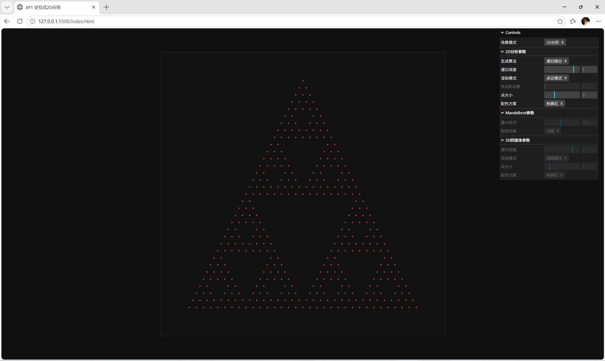
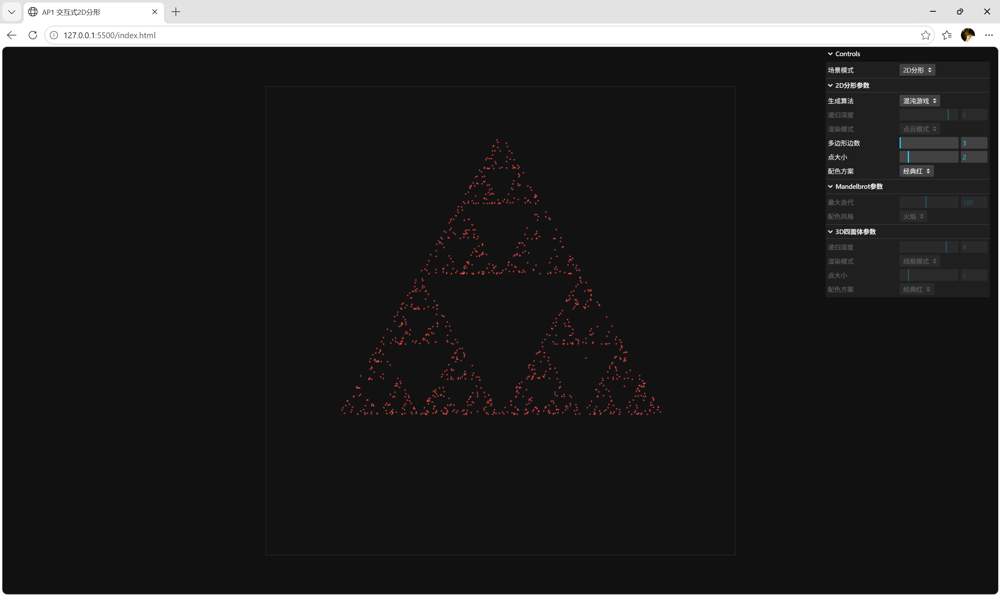
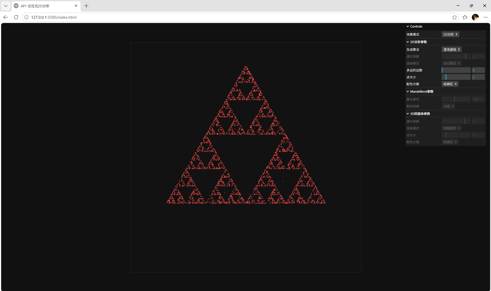
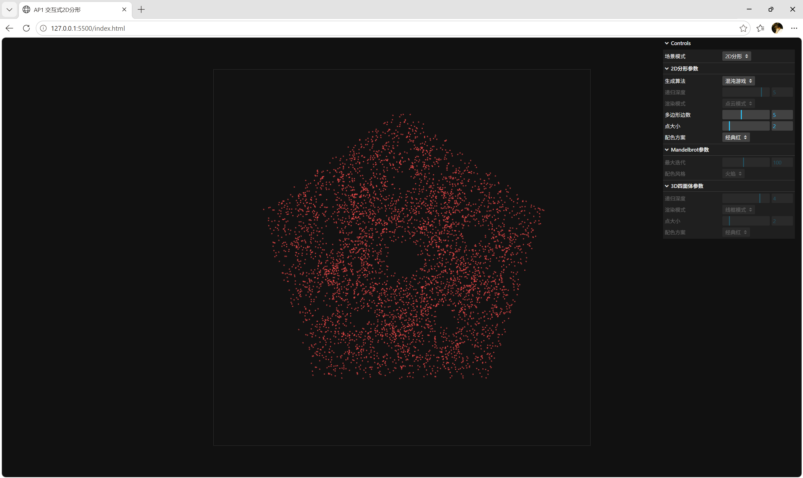
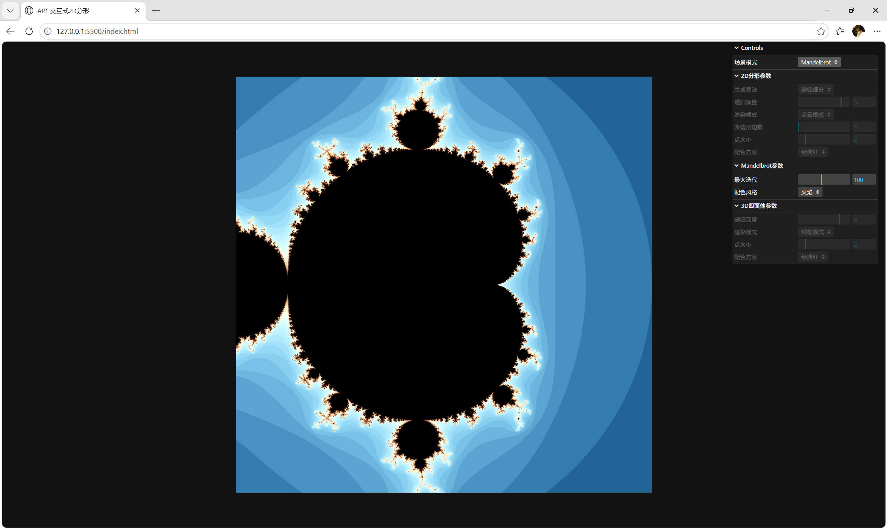
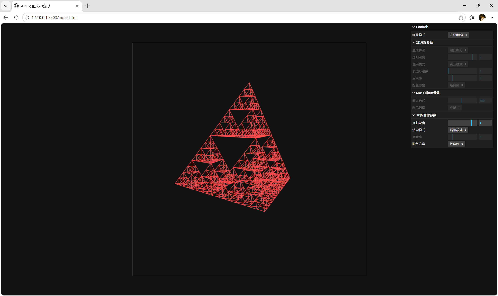

# AP1 交互式 2D 分形生成器

## 项目概述

本项目是计算机图形学课程的 AP1 作业，基于原生 WebGL 实现了交互式的 2D 分形生成与探索工具。核心实现了谢尔宾斯基三角形的两种经典生成算法（递归细分、混沌游戏），并扩展了 n 边形分形、曼德博集合、3D 四面体垫片等选做内容，支持参数实时调节、鼠标交互、键盘快捷键等操作。

## 功能清单

### 必做功能

-  递归细分算法生成谢尔宾斯基三角形
-  混沌游戏算法生成谢尔宾斯基三角形（带逐点生长动画）
-  三种渲染模式切换：点云 / 线框 / 实体
-  可视化参数控制面板（基于 lil-gui）
-  鼠标交互：左键拖拽平移、滚轮缩放
-  键盘快捷键：1/2/3 切换渲染模式，空格暂停混沌动画

### 选做扩展

-  任意 n 边形混沌游戏（3~8 边可调）
-  Mandelbrot（曼德博）集合交互探索器
-  3D 四面体 Sierpinski Gasket（支持三种渲染模式）
-  渲染质量优化：点平滑、线抗锯齿、3D 背面剔除
-  模块化代码结构：算法、UI、主逻辑分离

## 运行方式

1. 使用 VS Code 打开项目文件夹
2. 安装`Live Server`扩展（已安装可跳过）
3. 右键`index.html`，选择「Open with Live Server」
4. 浏览器自动打开页面，默认地址为 `http://127.0.0.1:5500/index.html`

> 
> 注意：请通过 HTTP 服务器运行，直接打开本地 HTML 文件会因跨域限制无法加载着色器。

## 操作说明

### 面板操作

右上角控制面板可切换所有功能，不同场景下不相关的参数会自动置灰禁用，避免混淆。

- **场景模式**：切换 2D 分形、曼德博集合、3D 四面体三大场景
- **2D 分形参数**：
  - 生成算法：切换「递归细分」与「混沌游戏」
  - 递归深度：控制分形的细分层级（0~6）
  - 渲染模式：切换点云、线框、实体三种显示方式
  - 多边形边数：混沌游戏模式下调节分形的边数（3~8）
  - 点大小：点云模式下调节点的尺寸
  - 配色方案：切换图形颜色
- **Mandelbrot 参数**：调节最大迭代次数、配色风格
- **3D 四面体参数**：调节递归深度、渲染模式、点大小、配色

### 鼠标操作

- **左键拖拽**：2D / 曼德博场景平移画面；3D 场景旋转视角
- **滚轮**：所有场景缩放画面

### 键盘快捷键

表格

| 按键 | 适用场景 | 功能 |
| --- | --- | --- |
| 1 | 2D 递归 / 3D 四面体 | 切换为点云模式 |
| 2 | 2D 递归 / 3D 四面体 | 切换为线框模式 |
| 3 | 2D 递归 / 3D 四面体 | 切换为实体模式 |
| 空格 | 2D 混沌游戏 | 暂停 / 继续逐点生长动画 |

## 算法原理

### 1. 递归细分算法

确定性的几何构造方法：从一个初始大三角形出发，每次将每个三角形拆分为三个全等的小三角形，挖去中心的倒三角形区域。重复这个过程直到达到指定的递归深度，最终得到具有自相似性的谢尔宾斯基垫片。

- 深度为 0 时，就是原始的单个三角形
- 深度为 n 时，共包含 3ⁿ 个小三角形
- 优点：图形精确、边缘锐利；缺点：深度增长时顶点数量指数级上升

### 2. 混沌游戏算法

基于迭代函数系统（IFS）的概率收敛方法：从多边形内任意一点出发，每次随机选中一个顶点，向该顶点移动一半距离并记录新的点。重复足够多次后，所有点会自发收敛到分形吸引子上，最终呈现出和递归细分一致的谢尔宾斯基结构。

- 本质是通过随机迭代逼近分形集合，点数越多越精确
- 优点：计算量和点数线性相关，高细节下性能更好；缺点：边缘是离散的点，精度有限
- 扩展到 n 边形时，调整顶点数量即可生成对应形状的分形吸引子

### 3. Mandelbrot 集合

通过片元着色器逐像素计算逃逸时间：对复平面上每个点 c，迭代公式 `z = z² + c`，若迭代中 z 的模超过 2 则判定为逃逸，根据逃逸时的迭代次数映射颜色。中心点永远不逃逸的区域即为曼德博集合。

### 4. 3D 四面体垫片

2D 谢尔宾斯基三角形的三维扩展：从正四面体出发，每次将每个四面体拆分为四个小四面体，挖去中心的正八面体区域，递归迭代得到三维自相似结构。

## 项目结构

```
AP1-Sierpinski/
├── index.html              # 主页面
├── js/
│   ├── main.js             # 主入口、渲染循环、场景管理
│   ├── fractal.js          # 所有分形算法实现
│   └── ui.js               # 参数面板、鼠标键盘交互
├── shaders/
│   ├── vertex2d.glsl       # 2D分形顶点着色器
│   ├── fragment2d.glsl     # 2D分形片元着色器
│   ├── mandelbrot_vert.glsl  # 曼德博顶点着色器
│   ├── mandelbrot_frag.glsl  # 曼德博片元着色器
│   ├── vertex3d.glsl       # 3D四面体顶点着色器
│   └── fragment3d.glsl     # 3D四面体片元着色器
├── Common/
│   ├── webgl-utils.js      # WebGL初始化工具
│   ├── initShaders.js      # 着色器加载工具
│   └── MV.js               # 矩阵运算库
└── README.md
```

## 效果截图

### 1. 2D 递归细分 - 实体模式



### 2. 混沌游戏 - 逐点生长过程




### 3. 五边形混沌游戏



### 4. Mandelbrot 集合



### 5. 3D 四面体垫片 - 线框模式



## 开发说明

- 基于原生 WebGL 2.0 实现，不依赖第三方图形引擎
- 代码采用模块化拆分，算法逻辑与交互逻辑分离，便于扩展
- 渲染管线做了基础优化：启用点平滑、线平滑、背面剔除和颜色混合